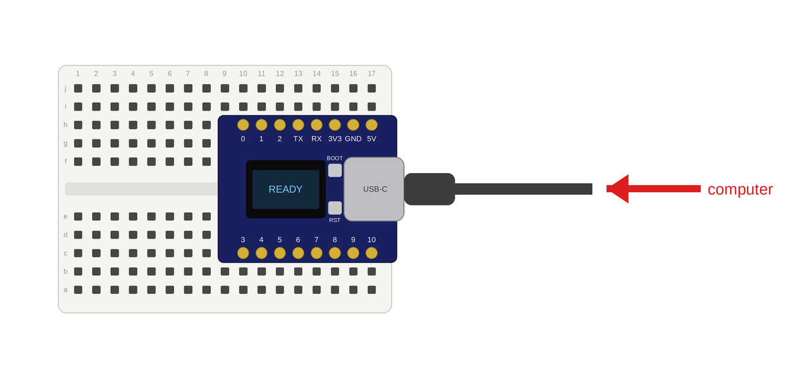
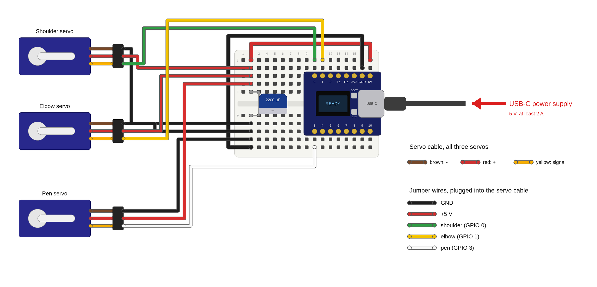

# BrachioGraph: a drawing robot with an ESP32

> **Looking for the details?** Everything about calibration, the web page, Wi-Fi, updates,
> other ESP32 boards, the HTTP API and troubleshooting is in **[EXPERT.md](EXPERT.md)**.

A robot arm with two joints holds a pen and draws what you send it from a
browser: pictures, photos or text. This guide takes you from plugging it
together to your first drawing.

Everything you need, with how many of each and the files to 3D-print, is in
[PARTS.md](PARTS.md).

## 1. Get the repository

Open a terminal on the Linux computer and type the commands, one line at a
time:

```sh
git clone https://github.com/tentator/brachiograph-esp32-nfd.git
cd brachiograph-esp32-nfd
pip install --user -r requirements.txt
```

The last line installs the tools that talk to the ESP32 (esptool, mpremote, mpy-cross).

## 2. Enter your Wi-Fi

```sh
cp customization.example.json customization.json
```

Open `customization.json` and fill in:

- `hostname`: your robot's name (the robot adds a dash and two characters of its own,
  e.g. `node11-60`, so two robots never get the same name)
- `networks`: the Wi-Fi networks it should join, the most important first
- `ota_password`: a password of your choice for updates over Wi-Fi
- `arms`: leave it at `"3d-printed"` for the printed arms from [PARTS.md](PARTS.md)
  (`"wooden"` if the elbow servo sits on the lower arm instead)

`customization.json` holds passwords and stays on your computer: Git never uploads it.

## 3. Connect the ESP32

Push the ESP32 into the breadboard across the middle gap, then plug the USB-C
cable into the ESP32 and into the computer.



## 4. Flash the program

```sh
./flash.sh
```

It finds the ESP32 among the USB ports by itself (if several could be one, it
asks which), puts MicroPython on it the first time, then copies the drawing
program, the web page and your `customization.json`. It asks before changing
anything; answer `y`. Later, without the USB cable, the same command updates
the robot over Wi-Fi: it first checks that it really found your robot and that
the password is right. `./flash.sh --help` shows the other options.

## 5. Build the robot

1. Press the breadboard into its place on the base.
2. Put the shoulder servo into the base, its shaft at the top.
3. Put the elbow servo into the end of the upper arm.
4. Put the pen-lift servo into the lower arm.
5. Wrap the rubber band around the lower arm: it holds the pen.
6. Press a servo horn into each arm: into the upper arm where it meets the
   shoulder servo, into the lower arm where it meets the elbow servo.

Don't put the arms onto the servos yet: that comes in step 7, with the robot
switched on.

TODO: photo of the base with breadboard and shoulder servo, and of both arms
with their servos, horns and rubber band.

## 6. Wire it up

Unplug the USB cable first. The servos get their power from the ESP32's `5V`
pin; the capacitor absorbs their current spikes.



| Wire colour | From | To |
|---|---|---|
| Black | ESP32 `GND` | breadboard column 2, lower half; from there each servo's ground and the capacitor's − (marked side) |
| Red | ESP32 `5V` | breadboard column 2, upper half; from there each servo's + and the capacitor's + |
| Green | ESP32 `0` | shoulder servo signal |
| Yellow | ESP32 `1` | elbow servo signal |
| White | ESP32 `3` | pen servo signal |

Each servo's own cable is brown (−), red (+) and yellow (signal). Plug it into
the jumper wires halfway: brown to black, red to red, yellow to the servo's
signal colour.

Then plug the USB-C power supply into the ESP32.

## 7. Mount the arms

Plug in the USB power supply: both arm servos turn to their middle position
and the pen servo lifts. This is the park position: the robot goes there when
it is switched on and after every drawing. Seen from above, with the shoulder at the top and the paper
below it:

```
   shoulder servo
   (on the base)
         O==============o
            upper arm   |  elbow
                        |
                        |  lower arm
   +--------------------|---------+
   |                    o  pen    |
   |                              |
   |            paper             |
   |                              |
   +------------------------------+
```

1. Put the upper arm on the shoulder servo, pointing straight to the right.
2. Put the lower arm on the elbow servo, pointing straight down towards the
   paper: a right angle at the elbow.
3. Put the lifter on the pen servo so that it holds the pen up, off the
   paper.

Don't turn the servos by hand while they are powered.

## 8. Tidy the cables

Run the elbow and pen servo cables along the arms and fix them with cable
ties. Leave enough slack at the shoulder and at the elbow, so the arms can
turn all the way without pulling on a cable.

TODO: photo of the finished robot, wired and ready for calibration.

## 9. Connect

Put your laptop on the same Wi-Fi as the robot, open a browser and go to
`http://<name>.local` with the name that `./flash.sh` printed at the end and
that the display shows, for example `http://node11-60.local`. Type the
`http://` too. The robot's page opens.

The small display on the ESP32 helps: it shows the robot's address when it's
ready, and says what went wrong if it couldn't join your Wi-Fi (for example
*wrong password* or *not in range*). Then the robot opens its own Wi-Fi
instead (named like the robot, e.g. `node11-60`), and the display shows its
name and address. If you can't see that Wi-Fi at all, add `"txpower": 8.5`
to `customization.json` and flash again: some boards can't send at full power. The blinking dot in the
display's corner and the LED on the board blink while the robot program
runs.

## 10. Calibrate

On the robot's page:

1. Under *Arms and Drawing Area*, set *View* to *from the paper side*, so
   drawings come out the right way up for you.
2. Under *Live Calibration*, set *Pen Up* so the pen clears the paper and
   *Pen Down* so it rests lightly on it; try them with *Toggle Pen*.
3. Press *Apply Config*, then *Draw Test Square*: its sides should be straight.
4. If a warning appears under the drawing area, press *Auto-fit Area to Arms*
   and *Apply Config* again.

Want even more precise drawings? At the bottom of the page, *Precise
Calibration* measures the arms on the printed BrachioGraph template
([images/template-grid.pdf](images/template-grid.pdf)),
line by line, and *Draw 1 cm Grid* shows how exact the robot is. This is
optional; [EXPERT.md](EXPERT.md#precise-calibration-optional) explains it.

## 11. Draw

Pick a picture (SVG), a photo or a text, check the preview and press
*Plot Drawing*. To start with, try the SVGs in [images/](images/): a hat, a
logo and a map of Switzerland. The robot keeps drawing on its own, even if you close the
browser.
