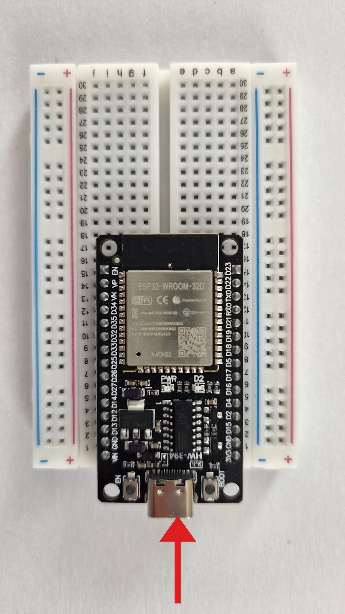
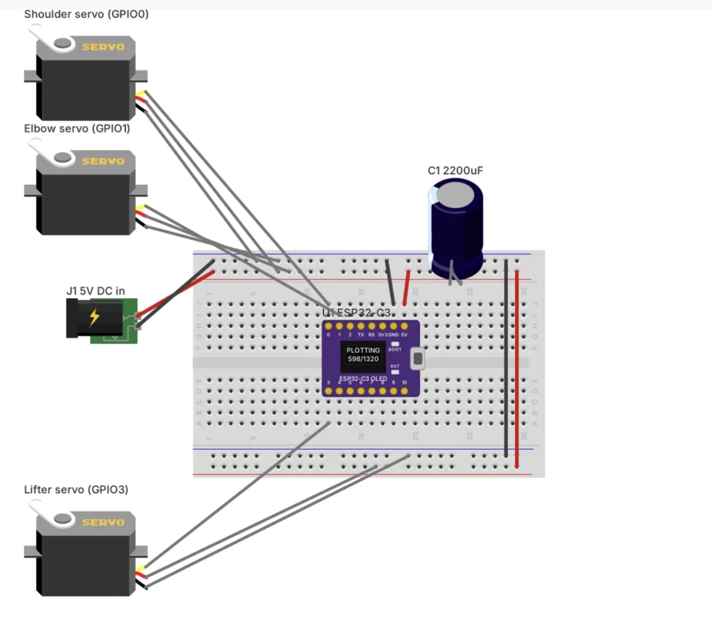

# BrachioGraph: a drawing robot with an ESP32

A robot arm with two joints holds a pen and draws what you send it from your
phone: pictures, photos or text. This guide takes you from plugging it
together to your first drawing.

## What you need

- ESP32 DevKit (30 pins) and a USB cable to the computer
- 3 servos: shoulder, elbow, pen
- 3D-printed base plate and 2 arms of 80 mm, the elbow servo sits on the upper arm
- Pen
- Breadboard, jumper wires, 1000 µF capacitor
- USB power supply, 5 V, at least 2 A
- Linux computer

## 1. Get the repository

Open a terminal on the Linux computer and type the commands, one line at a
time:

```sh
git clone https://github.com/tentator/brachiograph-esp32-nfd.git
cd brachiograph-esp32-nfd
pip install --user -r requirements.txt
```

The last line installs the tools that talk to the ESP32 (esptool, mpremote).

## 2. Enter your Wi-Fi

```sh
cp customization.example.json customization.json
```

Open `customization.json` and fill in:

- `hostname`: your robot's name
- `networks`: the Wi-Fi networks it should join, the most important first
- `ap`: name and password (at least 8 characters) of the robot's own Wi-Fi,
  which it opens when it finds none of the others

`customization.json` holds passwords and stays on your computer: Git never uploads it.

## 3. Connect the ESP32

Plug the USB cable into the ESP32 and into the computer.



## 4. Flash the program

```sh
./flash.sh
```

It downloads MicroPython, puts it on the ESP32, then copies the drawing
program, the web page and your `customization.json`. If your ESP32 is not on
`/dev/ttyUSB0`, give its port: `./flash.sh /dev/ttyUSB1`. Later, without the
USB cable, the same command updates the robot over Wi-Fi.

## 5. Wire it up



TODO: this placeholder shows the ESP32-C3 board; replace it with the ESP32 DevKit
wiring below.

Unplug the USB cable first. The servos get their power from the ESP32's `VIN`
pin; the capacitor absorbs their current spikes.

| Wire | From the ESP32 | To |
|---|---|---|
| Shoulder signal | `D25` | shoulder servo, yellow |
| Elbow signal | `D26` | elbow servo, yellow |
| Pen signal | `D27` | pen servo, yellow |
| +5 V | `VIN` | all servos, red, and capacitor + |
| Ground | `GND` | all servos, brown, and capacitor − (marked side) |

Then plug the USB power supply into the ESP32.

## 6. Mount the arms

Plug in the USB power supply: both arm servos turn to their middle position
and the pen servo lifts. This is the park position: the robot goes there when
it is switched on and after every drawing. Seen from above, with the shoulder at the top and the paper
below it:

```
   shoulder servo
   (on the base)
         O==============o
            upper arm   |  elbow
                        |
                        |  lower arm
   +--------------------|---------+
   |                    o  pen    |
   |                              |
   |            paper             |
   |                              |
   +------------------------------+
```

1. Put the upper arm on the shoulder servo, pointing straight to the right.
2. Put the lower arm on the elbow servo, pointing straight down towards the
   paper: a right angle at the elbow.
3. Put the lifter on the pen servo so that it holds the pen up, off the
   paper.

Don't turn the servos by hand while they are powered.

## 7. Calibrate

At the bottom of the web page, under *Live Calibration*:

1. Press *Bed Center*: the upper arm points 45° to the left, the lower arm is
   at a right angle to it. If not, adjust *S1 Park* (shoulder) and *S2 Park*
   (elbow).
2. With the buttons under *Safe Nudge Controls (±5°)*, check that 5° on the
   screen is 5° on the arm; if not, change *S1 Slope* or *S2 Slope*.
3. Set *Pen Up* so the pen clears the paper, and *Pen Down* so it rests
   lightly on it.
4. Press *Apply Config* and draw the test square with *Draw Test Square*: its
   sides should be straight.

## 8. Draw

On the web page, pick a picture (SVG), a photo or a text, check the preview
and press *Plot Drawing*. The robot keeps drawing on its own, even when the
phone sleeps.
