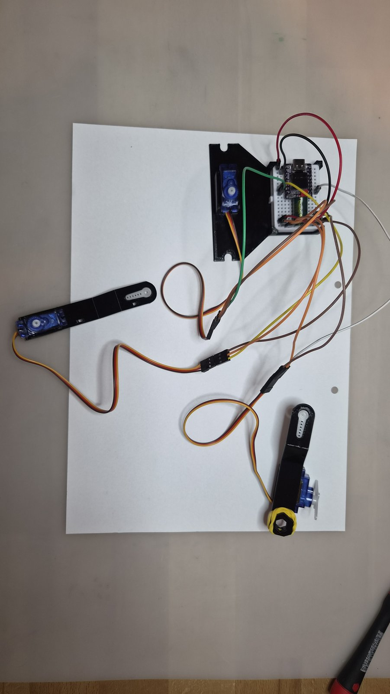
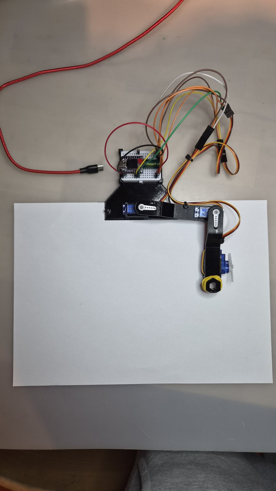

# BrachioGraph: a drawing robot with an ESP32

> **Looking for the details?** Everything about calibration, the web page, Wi-Fi, updates,
> other ESP32 boards, the HTTP API and troubleshooting is in **[EXPERT.md](EXPERT.md)**.

A robot arm with two joints holds a pen and draws what you send it from a
browser: pictures, photos or text. This guide takes you from plugging it
together to your first drawing.

Everything you need, with how many of each and the files to 3D-print, is in
[PARTS.md](PARTS.md).

## 1. Get the repository

Open a terminal on the Linux computer and type the commands, one line at a
time:

```sh
git clone https://github.com/tentator/brachiograph-esp32-nfd.git
cd brachiograph-esp32-nfd
pip install --user -r requirements.txt
```

The last line installs the tools that talk to the ESP32 (esptool, mpremote, mpy-cross).

## 2. Enter your Wi-Fi (optional)

The robot works without this step: it then opens its own Wi-Fi (see step 9).
To have it join your Wi-Fi and to update it later without the USB cable:

```sh
cp board_default_settings.json board_settings.json
```

Open `board_settings.json` and change two lines:

- `"networks": [],` becomes your Wi-Fi's name and password:
  `"networks": [{"ssid": "my-wifi", "password": "my-password"}],`
- `"ota_password": "",` gets a password of your choice for updates over Wi-Fi:
  `"ota_password": "my-update-password",`

Leave the rest as it is (you may delete the `"_about"` line).

`board_settings.json` holds passwords and stays on your computer: Git never uploads it.

## 3. Connect the ESP32

Push the ESP32 into the breadboard across the middle gap, then plug the USB-C
cable into the ESP32 and into the computer.


## 4. Flash the program

```sh
./flash.sh
```

It finds the ESP32 among the USB ports by itself (if several could be one, it
asks which), puts MicroPython on it the first time, then copies the drawing
program, the web page and your `board_settings.json`. It asks once before changing
anything; answer `y`. It prints only a few lines; `./flash.sh --verbose` shows
every step. If it says it has no access to the USB port, run `./deploy_udev.sh`
once (it asks for your computer's password) and plug the ESP32 in again. Later,
without the USB cable, `./flash.sh` updates the robot over Wi-Fi: it first checks
that it really found your robot and that the password is right.
`./flash.sh --help` shows the other options.

The robot keeps its calibration (what you set on its web page in step 10) when
you flash it again.

## 5. Build the robot

1. Press the breadboard into its place on the base.
2. Put the shoulder servo into the base, its shaft at the top.
3. Put the elbow servo into the end of the upper arm.
4. Put the pen-lift servo into the lower arm.
5. Wrap the rubber band around the lower arm: it holds the pen.
6. Press a servo horn into each arm: into the upper arm where it meets the
   shoulder servo, into the lower arm where it meets the elbow servo.

Don't put the arms onto the servos yet: that comes in step 7, with the robot
switched on.

TODO: photo of the base with breadboard and shoulder servo, and of both arms
with their servos, horns and rubber band.

## 6. Wire it up

Unplug the USB cable first. The servos get their power from the ESP32's `5V`
pin; the capacitor absorbs their current spikes.


| Wire colour | From | To |
|---|---|---|
| Black | ESP32 `GND` | breadboard column 1, rows a–e; the capacitor's − (marked side) goes there too |
| Red | ESP32 `5V` | breadboard column 1, rows f–j; the capacitor's + goes there too |
| Brown | breadboard column 1, rows a–e | each servo's − |
| Orange | breadboard column 1, rows f–j | each servo's + |
| Green | ESP32 `0` | shoulder servo signal |
| Yellow | ESP32 `1` | elbow servo signal |
| White | ESP32 `3` | pen servo signal |

Each servo's own cable is brown (−), red (+) and yellow (signal). Plug it into
the jumper wires halfway: brown to brown, red to orange, yellow to the servo's
signal colour.



## 7. Mount the arms

Plug the USB-C power supply into the ESP32: both arm servos turn to their
middle position and the pen servo lifts. This is the park position: the robot goes there when
it is switched on and after every drawing. Seen from above, with the shoulder at the top and the paper
below it:

```
   shoulder servo
   (on the base)
         O==============o
            upper arm   |  elbow
                        |
                        |  lower arm
   +--------------------|---------+
   |                    o  pen    |
   |                              |
   |            paper             |
   |                              |
   +------------------------------+
```

1. Put the upper arm on the shoulder servo, pointing straight to the right.
2. Put the lower arm on the elbow servo, pointing straight down towards the
   paper: a right angle at the elbow.
3. Put the lifter on the pen servo so that it holds the pen up, off the
   paper.

Don't turn the servos by hand while they are powered.

## 8. Tidy the cables

Run the elbow and pen servo cables along the arms and fix them with cable
ties. Leave enough slack at the shoulder and at the elbow, so the arms can
turn all the way without pulling on a cable.



## 9. Connect

With your Wi-Fi in `board_settings.json`: put your laptop on the same Wi-Fi as
the robot, open a browser and go to `http://<name>.local` with the name that
`flash.sh` printed at the end and that the display shows, for example
`http://plotter-60.local`. Type the `http://` too.

Without it, or if the robot can't join your Wi-Fi: it opens its own Wi-Fi
`ESP32-Plotter-<xx>` (password `plotterpassword`). Connect your laptop to it
and go to `http://192.168.4.1`. If Chrome on an Android phone shows
`ERR_TOO_MANY_RETRIES`, use another browser, for example Samsung Internet.

The robot's page opens. The small display on the ESP32 helps: it shows the
robot's address when it's ready, and says what went wrong if it couldn't join
your Wi-Fi (for example *wrong password* or *not in range*). If you can't see
the robot's own Wi-Fi at all, set `"txpower": 8.5`
in `board_settings.json` and flash again: some boards can't send well at high power. The blinking dot in the
display's corner and the LED on the board blink while the robot program
runs.

## 10. Calibrate

On the robot's page:

1. Under *Live Calibration*, set *Pen Up* so the pen clears the paper and
   *Pen Down* so it rests lightly on it; try them with *Toggle Pen*.
2. Press *Apply Config*, then *Draw Test Square*: its sides should be straight.
3. If a warning appears under the drawing area, press *Auto-fit Area to Arms*
   and *Apply Config* again.

Want even more precise drawings? At the bottom of the page, *Precise
Calibration* measures the arms line by line on two printed A4 templates, one in
front of the robot ([images/template-a4-front.pdf](images/template-a4-front.pdf))
and one turned round behind it
([images/template-a4-back.pdf](images/template-a4-back.pdf)), both on its two
pins; *Draw 1 cm Grid* on the front one shows how exact the robot is. If the
printed hole circles don't sit on the punched holes, try the `-shift3mm` versions. This is optional;
[EXPERT.md](EXPERT.md#precise-calibration-optional) explains it.

## 11. Draw

Punch two holes into an A4 sheet with an office hole punch, along one of its long
edges. Lay it across (landscape) with the holes at the top and fit it onto the
two pins of the A4 bracket, the robot at that edge: the sheet is then always in
the same place.

Pick a picture (SVG), a photo or a text, check the preview and press
*Plot Drawing*. To start with, try the SVGs in [images/](images/): a hat, a
logo and a map of Switzerland. The robot keeps drawing on its own, even if you close the
browser.
